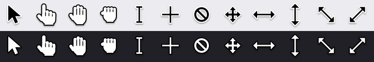

# cursorkit

Mouse cursors as **SVG**, with the click point as data.



```bash
npm i cursorkit
```

```ts
import { cursor } from "cursorkit";

el.style.cursor = cursor("pointer").css;
// url("data:image/svg+xml,…") 11 4, pointer
```

Zero dependencies. Original drawings, MIT licensed, not copied from macOS or Windows.

---

## Why this exists

Ask a coding agent for a cursor and you get one of three things: a hand-traced
path that comes out lopsided, a line icon (Lucide's `mouse-pointer`) pretending
to be a cursor, or a cursor whose tip sits a few pixels away from the point that
actually clicks. Cursor packs that do look right are usually Apple's artwork,
with no licence and no hotspot.

cursorkit is the part that's tedious to get right by hand: a fill, an outline
that reads on any background, a soft shadow, and the **hotspot**, the exact
pixel that clicks, shipped with every image.

## The one thing to know

**Place the hotspot, not the corner.** The image's top-left corner is not where
the cursor points:

```ts
const c = cursor("arrow", { size: 2 });
img.src = c.dataUri;
img.style.left = `${x - c.hotspot.x}px`;
img.style.top = `${y - c.hotspot.y}px`;
```

`hotspot` is in whole pixels at every size, so the CSS hotspot is exact too.

---

## API

### `cursor(name, options?) → Cursor`

```ts
cursor("grab", { theme: "dark", size: 1.5 });
// { name, svg, width, height, hotspot: { x, y }, dataUri, css }
```

| Option | Default | |
|---|---|---|
| `theme` | `"light"` | `"dark"` draws for dark backgrounds: white arrow, black edge. Hands stay white on both, as they do on every OS. |
| `size` | `1` | 1 is about the size an OS draws its cursor. Keep CSS cursors at 1 (32px or less); go bigger for demos, mockups and video. |
| `shadow` | `true` | Soft drop shadow. The image already includes room for it. |
| `ink`, `paper` | `#000`, `#fff` | Recolour: `ink` is the arrow's body and the hand's outline, `paper` the other. |

### `cursorCss(name, options?) → string`

Shorthand for `cursor(name, options).css`: image, hotspot and keyword fallback in one value.

### `names`, `fallbackOf(name)`

Every cursor name, and the CSS keyword it stands for.

## Cursors

| Name | CSS keyword | Size | Hotspot |
|---|---|---|---|
| `arrow` | `default` | 23×29 | 4, 4 |
| `pointer` | `pointer` | 29×31 | 11, 4 |
| `grab` | `grab` | 27×29 | 15, 14 |
| `grabbing` | `grabbing` | 25×25 | 13, 11 |
| `text` | `text` | 16×26 | 7, 12 |
| `crosshair` | `crosshair` | 26×26 | 12, 12 |
| `not-allowed` | `not-allowed` | 24×24 | 11, 11 |
| `move` | `move` | 26×26 | 12, 12 |
| `ew-resize` | `ew-resize` | 32×18 | 15, 8 |
| `ns-resize` | `ns-resize` | 18×32 | 8, 15 |
| `nwse-resize` | `nwse-resize` | 26×26 | 12, 12 |
| `nesw-resize` | `nesw-resize` | 26×26 | 12, 12 |

Sizes and hotspots are for the static files (size 1, with shadow); light and dark match.

## Without installing anything

Every cursor is a static file, and `cursors.json` holds its hotspot:

```css
.canvas { cursor: url("https://cdn.jsdelivr.net/npm/cursorkit@0.1/svg/light/grab.svg") 15 14, grab; }
```

```
https://cdn.jsdelivr.net/npm/cursorkit@0.1/svg/{light|dark}/{name}.svg
https://cdn.jsdelivr.net/npm/cursorkit@0.1/cursors.json
```

## CLI

```bash
$ npx cursorkit pointer > public/cursors/pointer.svg
hotspot 11 4 · 29×31 · falls back to pointer

$ npx cursorkit arrow --css --theme dark
$ npx cursorkit grab --size 2 --json
$ npx cursorkit list
```

The hotspot goes to stderr, so redirecting stdout gives a clean file.

## For coding agents

An [Agent Skill](skills/cursorkit/SKILL.md) tells the agent to take cursors from
here instead of drawing them, and how to place them:

```bash
npx skills add pallaoro/cursorkit
```

The plain-text summary for LLMs is [llms.txt](llms.txt).

## When not to use it

In a real app UI, the browser's own cursor is the right one: `cursor: pointer`
already matches the user's OS and accessibility settings. Reach for cursorkit
when the cursor has to be *drawn*: a product demo or landing-page mockup, a
screenshot or launch video made in code, an agent's on-screen pointer, or a
deliberately custom CSS cursor.

## Development

```bash
npm install
npm run build   # tsc, then svg/, cursors.json and assets/preview.svg
npm test        # includes pixel checks of every hotspot (needs rsvg-convert)
npm run demo    # http://localhost:4173/demo/
```

The pixel tests rasterise each cursor and check the hotspot against the
drawing: nothing drawn above or left of a tip beyond the outline, symmetric
cursors centred on their hotspot, hands holding it in the palm, and nothing
clipped by the image edge.

## Licence

MIT, code and drawings. The shapes are original; they follow the conventions
every OS shares (an arrow, a pointing hand) without copying any vendor's artwork.
